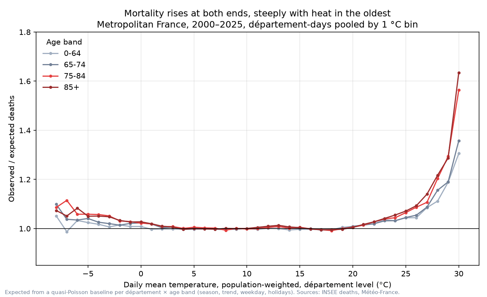
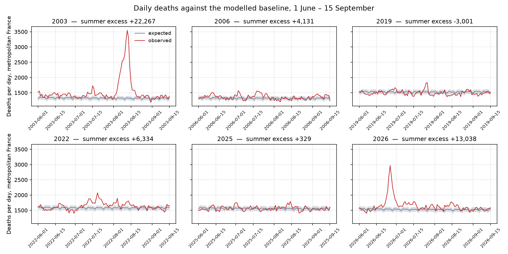

# fr-temp-mortality

Daily all-cause mortality in France (INSEE, 1970–) joined to Météo-France station
temperatures, modelled with distributed-lag non-linear models by département and age,
with an early-warning evaluation, cross-country comparison and 2050 scenarios.
Published as a dashboard.

## Pre-registered modelling choices (fixed before looking at results)
- Spatial unit: département (96 metropolitan). Period for models: 2000-01-01 onward.
- Age bands: 0–64, 65–74, 75–84, 85+.
- Exposure: population-weighted daily mean temperature from 3–8 stations per département.
- Model: quasi-Poisson, cross-basis with natural splines, knots at the 10th/75th/90th
  percentiles, lag 0–21, 8 df per year for season/trend, day-of-week, holidays.
- Exclusion: 1 Mar 2020 – 30 Jun 2021 (sensitivity analysis includes them).
- Validation: 2000–2019 for fitting and tuning; 2022–2025 held out.

## Validation
Expected deaths come from a quasi-Poisson baseline per département × age band (see docs/decisions.md).
Model excess vs Santé publique France / InVS published excess:

| Episode | Window | SPF / InVS | This model | Ratio |
|---|---|---|---|---|
| 2003 | 1–20 Aug | 14,802 | 15,482 | 1.05 |
| 2006 | 11–28 Jul | 2,065 | 1,957 | 0.95 |
| 2019 | 24 Jun–7 Jul | 567 | 509 | 0.90 |
| 2019 | 21–27 Jul | 868 | 661 | 0.76 |
| 2026 | 17 Jun–2 Jul | 5,764 (provisional) | 7,247 | 1.26 |

SPF figures are from memory of the published bulletins and are being verified; 2022 is omitted because SPF's figure covers only département-days under canicule vigilance.

Between 2000 and 2025, about 48,800 deaths a year in metropolitan France were attributable to cold and 3,850 to heat — 8.6 % and 0.7 % of all deaths (95 % intervals 5.3–11.8 % and 0.2–1.1 %). Cold kills through many moderately cold days (92 % of the cold burden); heat through a few extreme ones (64 % of the heat burden comes from days above the 97.5th percentile). Among the over-85s, one death in eight is attributable to cold.

Département-level differences in sensitivity are not explained by climate (mean temperature has no effect once curves are expressed on each département’s own percentile scale) but by urbanity: at the 99th percentile the over-85s’ relative risk is 1.18 in rural départements and 1.30 at 30 % urban share, with Paris far above; density, latitude and coastal location together explain a quarter of the between-département variance (I² 44 % → 34 %), leaving a residual to test against income and care-home provision.

## Run
`make all`
